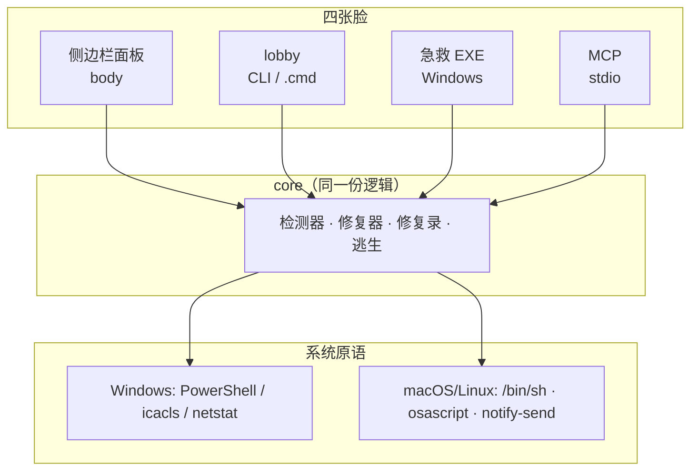

# DSH Doctor · DSH 私人医生

<div align="center">


### 点一下修复。

**DSH 桌面端把你桌面图标搞白了、整桌闪了、插件把会话炸了？点一下。**

一个**证据驱动**的桌面端健康检查与修复插件：侧边栏一个「私人医生」，
体检每条问题都带路径和原始证据，能修的给一个「一键修复」，改前备份、改完复检、坏了好回滚。

[](https://github.com/jincheng3870682453-hash/dsh-doctor/releases)
[](https://github.com/jincheng3870682453-hash/dsh-doctor/releases)
[](https://github.com/jincheng3870682453-hash/dsh-doctor/actions)
[](LICENSE)
[](#-平台支持)
[](plugin/package.json)

[为什么](#-为什么需要它) · [能修什么](#-能修什么) · [快速开始](#-快速开始) · [界面](#-界面) · [架构](#-架构) · [协议](#-社区检查包协议-v1) · [逃生](#-最后一招交接报告--网页版) · [安全](#-安全设计) · [FAQ](#-常见问题)

</div>

---

## 🩺 为什么需要它

DSH 桌面端在 Windows 上会改动系统状态，而且**不回收**：

```text
DSH 注册工作区 = C:\Users\<你>\Desktop
        ↓  每次给工作区授沙箱写权限
icacls 盖上三件套：
  S-1-4-xxx:(OI)(CI)(W,D,DC)            ← 能力 ACE，放行写入
  Everyone:(CI)(DENY)(DC)               ← 拒绝删除，永不回收
  Mandatory Label\Low:(OI)(CI)(NW)      ← ★ 元凶：桌面被降成低完整性
        ↓
Explorer 在低完整性目录里取不到图标
        ↓
整个桌面的快捷方式、文件夹变成白纸
```

修好之后**必然复发**——只要这个工作区还在，下次供给就又盖一遍。
所以删图标缓存、`ie4uinit -show`、重启电脑都没用；真正有效的是改回标签 **并把工作区从注册表里移出去**。

同样不讲道理的还有：插件把宿主包写进 `dependencies` 导致同一进程两份 `dsh-tools`；
插件用 `kind: "plugin"` 往会话里注入消息被 v4 拒收；崩溃自修复把 `cordis.patch.yml` 清空……
完整清单：[docs/traps.md](docs/traps.md)（已收录 14 类）。

## 🔧 能修什么

| | 检查 | 现象 | 一键修 |
|---|---|---|---|
| 🖥️ | 桌面 Low 完整性标签 | 图标全变白纸 | ✅ |
| 📌 | 工作区注册在桌面 / 用户目录 / 盘根 | 白图标反复复发 | ✅ 走 DSH 自己的注册表服务 |
| 📦 | profile 里出现宿主包副本 | `reading 'prepare'` 崩溃 | ✅ 只挪副本，不伤同目录插件 |
| 🧩 | `cordis.patch.yml` 被崩溃自修复清空 | 主题/模型/provider/MCP 全没了 | ✅ 从最近备份恢复 |
| 🌀 | 会话把桌面当工作区 | 整桌图标一起闪 | 提示（修复走工作区那条） |
| 💬 | 老会话含 v4 拒收的 `kind:"plugin"` | 会话打不开、每轮报错 | 只报告（改写会话风险高） |
| 🔐 | credentials 版本缺失 / 不符 | host 起不来 | 只报告 |
| 🧭 | PATH 里 `dsh` 指向死路径 | "命令莫名其妙不工作" | 只报告 |
| 🧾 | 桌面端崩溃日志 | 定位历史事故 | 只报告 |
| 🏚️ | 上次逃生实例已失效 | 旧标签页 `Failed to fetch` | 只报告（关掉旧标签页即可） |

完整目录（备份位置 / 验证方式 / 为什么不自动修）：**[docs/catalog.md](docs/catalog.md)**。

## ⚡ 快速开始

### 插件（推荐）

在 DSH 里把本仓库的 `plugin/` 装成 bundle：

```text
plugin_manager  install_bundle  target: <本仓库路径>/plugin
```

装好后侧边栏出现「私人医生」：平时完全无感，只在有高危问题时亮红点；点开就是体检面板。

### 急救 EXE（双端都死了也能用）

下载 **[Releases](https://github.com/jincheng3870682453-hash/dsh-doctor/releases)** 里的 `dsh-doctor.exe`（约 261 KB，自包含）：

```text
不需要 DSH · 不需要 Node · 不需要联网
```

双击进菜单：体检 / 修桌面图标 / 移除危险工作区 / 隔离宿主包副本 / 恢复 patch 层 /
**从备份回滚** / **起网页版逃生**。也支持 `dsh-doctor.exe scan`。

### 命令行

```powershell
.\dsh-doctor.cmd scan                     # 只读体检
.\dsh-doctor.cmd fix -Id desktop-label    # 修桌面图标变白
.\dsh-doctor.cmd report                   # 生成可提交给官方的报告包
```

## 🖥️ 界面

```text
DSH 私人医生                    3 个高危 · 1 条提醒        [测试通知] [起网页版] [重新体检]
─────────────────────────────────────────────────────────────────────────────
🔴 工作区被注册到了「桌面本身」
   每次授沙箱权限都会重新盖一遍 Low 标签和拒绝项 → 图标反复变白。
   C:\Users\你\Desktop                                    [一键修复]
─────────────────────────────────────────────────────────────────────────────
🟡 检测到桌面端崩溃日志：4 个
   C:\Users\你\AppData\Roaming\@deepseek-ai\dsh-desktop\logs
─────────────────────────────────────────────────────────────────────────────
修复录 · 最近 3 条
✅ rescue-web  2026-10-23 19:39 网页版已启动 http://127.0.0.1:48832/
❌ rescue-web  2026-10-23 19:34 启动失败：spawn EINVAL
```

## 🏗️ 架构



| 层 | 说明 |
|---|---|
| 面板 | `sidebar.panellist` + `main` 槽位，同源路由 `/dsh-doctor/status`、`/fix`、`/history`、`/rescue`、`/notify` |
| 核心 | `plugin/lib/index.js` 一份逻辑，CLI / EXE / MCP 都复用 |
| 原语 | 平台命令抽象成 `shell()`：Windows 走 PowerShell，其它走 `/bin/sh` |
| 数据 | 修复录 `~/.dsh/dsh-doctor/history.jsonl`，备份 `~/.dsh/dsh-doctor-backups/` |

## 🧩 社区检查包协议 v1

**你踩到的新坑，不用改引擎——写一个 JSON 就行。** 放进 `%USERPROFILE%\.dsh\dsh-doctor\checks\`，下次体检自动加载：

```json
{
  "protocolVersion": 1,
  "id": "my-pack",
  "title": "我自己踩过的坑",
  "checks": [
    {
      "id": "my-pack:workspace-on-desktop",
      "title": "工作区注册到了桌面",
      "severity": "high",
      "detect": { "type": "workspace-risky-path" },
      "fix": { "type": "workspace-entry" }
    }
  ]
}
```

- 协议：[docs/protocol.md](docs/protocol.md)
- Schema：[protocol/check-pack.schema.json](protocol/check-pack.schema.json)
- 示例：[examples/checks/example-pack.json](examples/checks/example-pack.json)

可用检测原语：`workspace-risky-path`、`desktop-low-label`、`profile-host-duplicate`、`desktop-session-activity`、
`crash-logs`、`session-legacy-kind`、`credentials-version`、`patch-layer-missing`、`path-dead-dsh`、`rescue-instance-dead`、
`acl`、`file-regex`、`dir-contains`。
可用修复动作：`desktop-label`、`workspace-entry`、`profile-host-dup`、`restore-patch-layer`。

## 🚪 最后一招：交接报告 + 网页版

**网页版不是"平替"，是最后手段。** 还有能一键修好的问题时，第一次点「起网页版」只会提醒先修；再点一次才启动。

启动时它会：① 在桌面生成 `dsh-doctor-交接-<时间>.md`（体检结果 + 已试过的修复 + 给网页版 DSH 的话）；
② 起隔离端口实例（日志落 `~/.dsh/dsh-doctor/rescue-<port>.log`）；③ **用带 token 的地址**打开浏览器；
④ 提示你把那份 MD 拖给网页版 DSH 接着修。再次点击会**复用**已在运行的实例。

## 🔒 安全设计

1. **默认只读**：体检与报告不写任何东西；
2. **每个修复三步**：备份 → 最小改动 → 立刻复检，复检失败就报错并还原，不返回"成功"；
3. **没有 shell 通道**：检查包只能声明「检测原语 + 内置修复 id」，不能执行任意命令；
4. **不碰安装目录**：不改 `app.asar`、不写 DSH 安装路径、不注册服务/驱动；
5. **改动可回滚**：ACL 有 `icacls /save` 备份，注册表有 `.bak-<时间戳>`，隔离的副本挪回即可。

## 🖥️ 平台支持

核心逻辑与平台无关——**DSH 插件能装在哪，医生就能跑在哪**。

| 能力 | Windows | macOS | Linux |
|---|---|---|---|
| 桌面 ACL / 完整性标签 | ✅ | —（POSIX 权限位检查） | —（同左） |
| 一键修桌面图标 | ✅ | 不适用 | 不适用 |
| 工作区 / 宿主包 / 会话 / patch / credentials | ✅ | ✅ | ✅ |
| 崩溃日志 | `%APPDATA%` | `~/Library/Logs` | `~/.config` |
| 系统通知 | 页面通知 → DSH | 页面通知 → DSH | 页面通知 → DSH |
| 网页版逃生 | ✅ | ✅ | ✅ |
| 急救 EXE | ✅ | 用面板 / MCP | 用面板 / MCP |

## ❓ 常见问题

**会不会把我桌面搞得更坏？**
不会。改桌面前有备份，验证失败会还原。真实案例：桌面标签改回 Medium、桌面工作区移出注册表、崩溃日志归档。

**为什么通知显示来自 DSH？**
通知由页面（渲染层）发出，所以系统归因是 DeepSeek Harness；host 侧 PowerShell 弹窗默认关闭（`DSH_DOCTOR_NOTIFY=host` 可开）。

**能修显卡 / 驱动 / HDR 那种花屏吗？**
不能，也不假装能。这类问题只给线索，并明确标成"不是 DSH 的锅"。

**数据会上传吗？**
不会。全部本地运行，没有遥测；`report` 生成的文件要不要提交由你决定。

**怎么卸载？**
设置 → 插件里停用，或 `plugin_manager remove_bundle target: dsh-doctor`。

## 🗺️ Roadmap

- [x] v0.1 检测器 + 一键修复 + 侧边栏面板
- [x] v0.2 工作区修复走 DSH 服务、社区检查包协议 v1、崩溃自修复恢复
- [x] v0.3 修复录、网页版逃生、常驻守护、MCP 面、修复目录
- [x] v0.4 跨平台、通知归因、交接报告、逃生复用
- [ ] v0.5 守护安装向导（开机自启 / 托盘 / 一键卸载）+ AUMID 通知
- [ ] v0.6 修复动作插件化（社区可评审后新增原语）

## 🤝 贡献

- 新坑：按 [协议](docs/protocol.md) 写一个 JSON 检查包，提 PR 到 `examples/checks/`，并在 `docs/traps.md` 补一条现象与根因；
- 代码：保持"只读优先、可回滚、失败不抛"三条纪律；
- 报告：`dsh-doctor report` 生成报告包，提交前自己看一眼。

## 📄 License

MIT

> ⚠️ 非官方项目。DSH 是杭州深度求索的产品；本项目只检查与修复**本机状态**，不修改 DSH 安装文件，也不代表官方立场。
