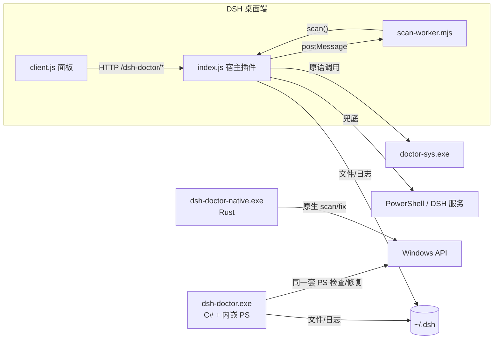
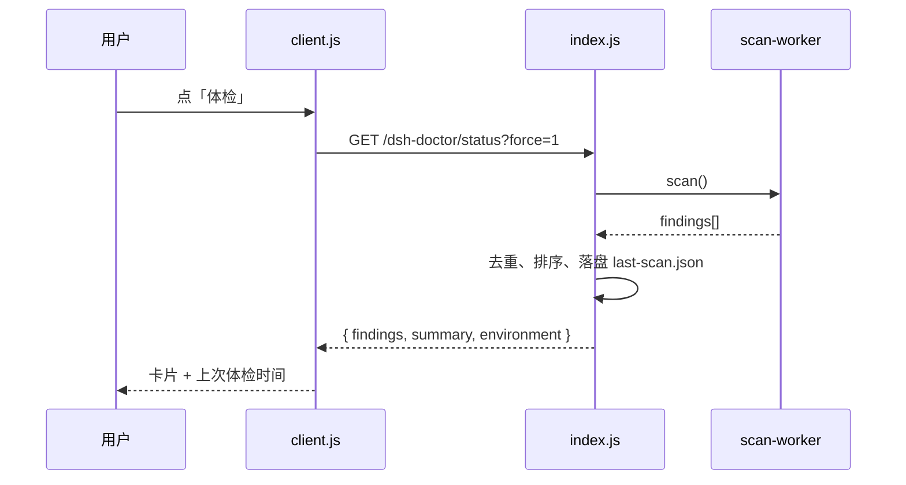
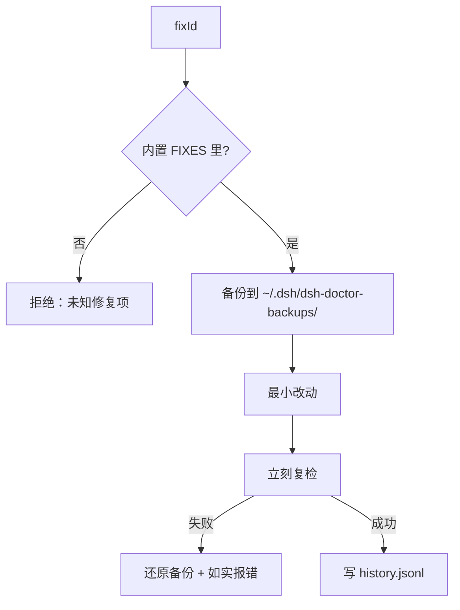

# 给贡献者的架构速览

> 这是给**想改代码 / 加检查 / 修 bug** 的人准备的：10 分钟看懂整个项目是怎么跑的。
> 只想知道怎么用，看 [README](../README.md)；想查具体症状，看 [fixable.md](fixable.md)。
> 更深的设计取舍（ADR、版本策略）在 [design.md](design.md)。

## 1. 一句话结构

同一个故障，项目里用**三套运行时**去够它：

| 运行时 | 入口 | 什么时候用 | 依赖 |
|---|---|---|---|
| **插件（JS）** | `plugin/lib/index.js`（宿主）+ `plugin/lib/client.js`（面板） | DSH 还能启动，平时体检/修复 | DSH 宿主 |
| **EXE（内嵌 PowerShell）** | `src/dsh-doctor.ps1` + `src/lib/*.ps1`，由 C# 启动器打进 `dsh-doctor.exe` | DSH 起不来，急救箱 | Windows 自带 PowerShell |
| **Rust 引擎** | `doctor-sys/src/*.rs` → `doctor-sys.exe` / `dsh-doctor-native.exe` | 底层原语（ACL/标签/进程/端口）与原生 CLI | 零第三方依赖 |

三套共用一套**检查 id / 修复 id / 备份格式**，所以面板、EXE、社区检查包说的是同一种语言。



## 2. 代码地图

```
plugin/                 ← 主发布物（npm: dsh-doctor-plugin）
  lib/index.js          ← 宿主：检查、修复、HTTP 路由、自动守护（~2700 行，先看 scan()）
  lib/client.js         ← 浏览器面板：按需体检、卡片、一键修复
  lib/scan-worker.mjs   ← 把 scan() 丢到 worker，避免卡界面
  package.json          ← 必须声明 dsh.bundle.patch；name 决定客户端模块 id
  cordis.patch.yml      ← bundle 安装行（id/name 必须等于包名）

src/                    ← EXE 用的 PowerShell 实现
  dsh-doctor.ps1        ← 参数分发（scan/fix/report/diff/version）
  lib/checks.ps1        ← 检查表（JS 检查的 PS 对应物）
  lib/fixes.ps1         ← 修复表（备份 → 改 → 复检 → 复原）
  lib/common.ps1        ← ACL/JSON/进程等原语
  lib/report.ps1        ← 报告与差异
tools/
  build.ps1             ← 一键打包（PS 拼接 → C# 启动器 → EXE、unix tar、env pack、插件 zip）
  rescue-main.ps1       ← EXE 的交互菜单与「起网页版（逃生）」
  cli.mjs               ← 跨平台 CLI，直接复用 plugin/lib/index.js
doctor-sys/             ← Rust：零依赖原语引擎（JSON over stdio）+ 原生 CLI
  src/win.rs            ← Windows API（ACL、完整性标签、进程、端口、通知）
  src/doctor.rs         ← 原生 scan/fix（P1，内部使用）
  src/json.rs           ← 手写 JSON（不引 crate）
tests/                  ← bridge / sanitize / mcp / label-pattern / smoke
docs/                   ← 就是你正在看的这些；catalog/traps/protocol 是契约
.github/workflows/      ← ci.yml（多平台 smoke） + build.yml（打包 + Release）
```

## 3. 一次「体检」怎么走



要点：

- `scan()` 按**内置检查表**顺序跑；每个检查必须自己兜异常，失败降级成一条 `check-failed`，绝不带崩整轮。
- 结果 8 秒内存缓存；修复后带 `?force=1` 强制重扫。
- 面板打开**不扫描**，只读 `~/.dsh/dsh-doctor/last-scan.json`；这是有意设计（老版本一开面板就全量扫描，慢且像卡死）。
- 社区检查包（`~/.dsh/dsh-doctor/checks/*.json`）在 `scan()` 末尾合并，只能声明**原语 + 内置修复 id**，没有 shell 通道。

## 4. 一次「修复」怎么走



约束（评审会看）：

1. **先备份、可回滚**；失败要还原，不能"改一半"。
2. **能用 DSH 自己的服务就不改文件**；改文件只做最小动作。
3. 修复 id 必须同时出现在 `docs/catalog.md`；自动修复还要有防抖上限。
4. 破坏性动作（删会话、改权限、重启服务）默认拒绝，必须给用户明确提示。

## 5. 三条特殊链路

### 5.1 逃生（起网页版）

```
rescueWeb() → findRuntime()（dsh → npx @next）
           → 若 dsh.cmd 存在：解析 node_modules/@deepseek-ai/dsh/lib/bin.js，用 node 直接起
             （dsh.cmd shim 会吞掉 stdout，拿不到 token）
           → dsh web --port <random> --no-open
           → 从日志抓 http://127.0.0.1:<port>/?token=...
           → 打开带 token 的地址 + 写桌面交接报告
```

### 5.2 自动守护

`startAutoGuard(ctx)` 每 30 秒：
- 桌面完整性标签被降级 / 被塞拒绝 ACE → 拉回 + 刷外壳；
- profile 出现宿主包副本（schemastery 等）→ 自动隔离（每小时上限 3 次）。

两项都有防抖：**不和 DSH 打乒乓**，超过上限就停下来提示用户改工作区。

### 5.3 会话权限一键修

`permission-too-broad` 修复：往旧会话日志**末尾追加**合法事件
（`permission/preset` → `sandbox/mode` → `approval/policy`），回放时最后一条生效；
投影缓存同步更新；原文件先备份；跳过当前会话。

## 6. 数据与备份

| 路径 | 内容 |
|---|---|
| `~/.dsh/dsh-doctor/last-scan.json` | 上次体检结果（面板秒开） |
| `~/.dsh/dsh-doctor/history.jsonl` | 修复录（超过 256 KB 轮转 `.1`） |
| `~/.dsh/dsh-doctor-backups/` | ACL / patch / 宿主包副本 / 会话权限修复的备份 |
| `~/.dsh/dsh-doctor/checks/` | 社区检查包 |
| `~/.dsh/dsh-doctor/rescue-*.log` | 逃生实例的输出（含 token，注意脱敏） |
| `~/.dsh/sessions/**/session*.jsonl.zstd` | 会话日志（追加事件改权限时要小心） |

报告一律先过 `sanitizeText()`：用户名 / 主机名 / 邮箱 / 用户主目录替换成 `user`、`<machine>`、`user@example.com`。

## 7. 加一个检查/修复（两种运行时都要）

> 这是本项目最容易踩的坑：**EXE 走 PS 检查表，插件走 JS 检查表**，只加一边就会出现"面板能报、EXE 不报"。

1. `plugin/lib/index.js`：写 `checkXxx()` → 加进 `scan()` 的 `builtin` 数组 → 需要修复就加 `FIXES` 条目并给 finding 填 `fixId`；
2. `src/lib/checks.ps1`：写对应的 `Test-DoctorXxx()` → 加进 `Invoke-DoctorScan` 列表；
3. `docs/catalog.md` 加一行（版本号、可修复与否）；必要时 `docs/traps.md` / `bugs/` 补案例；
4. `tests/` 加最小可复现用例；`tools/build.ps1` 全量构建，`dsh-doctor.exe scan` 和 `node tools/cli.mjs scan` 都要跑一遍；
5. CI 会跑多平台 smoke + Rust selftest；tag 后 `build.yml` 出 3 个 Release 资产。

## 8. 本地调试

```powershell
node tools/cli.mjs scan                 # 与面板同逻辑的只读体检
node tools/cli.mjs fix profile-host-dup # 需要时手动修复
.\dist\release\dsh-doctor.exe scan      # EXE 侧（注意：任意未知参数会进交互菜单）
.\dist\release\dsh-doctor-native.exe scan --json
```

假家目录测试（不碰真实状态）：

```powershell
$env:DSH_HOME = "$env:TEMP\fake-dsh"; New-Item -ItemType Directory "$env:DSH_HOME\storages" | Out-Null
node tools/cli.mjs scan
```

## 9. 工程约定（评审清单）

- `.ps1` 必须带 **UTF-8 BOM**（PS 5.1 的硬要求，CI 有守卫）；
- 文档/代码不用 emoji；
- 改动必须可回滚，修复先备份；
- 新检查/修复要同时覆盖 JS 与 PS 两侧（或明确标注只在某一侧）；
- 不碰 DSH 安装目录、不注册服务/驱动；
- 报告与日志默认脱敏；
- 客户端模块 id / patch 行 name / 包名三者一致（`bundle-identity-drift` 检查就是为此）。

## 10. 想先看什么

| 想做什么 | 先读 |
|---|---|
| 修一个具体症状 | [fixable.md](fixable.md)、[traps.md](traps.md) |
| 加一个检查 | 本文 §3/§7 + [catalog.md](catalog.md) |
| 改架构/版本策略 | [design.md](design.md) |
| 理解检查包协议 | [protocol.md](protocol.md) |
| 帮人恢复数据 | [recovery.md](recovery.md) |
